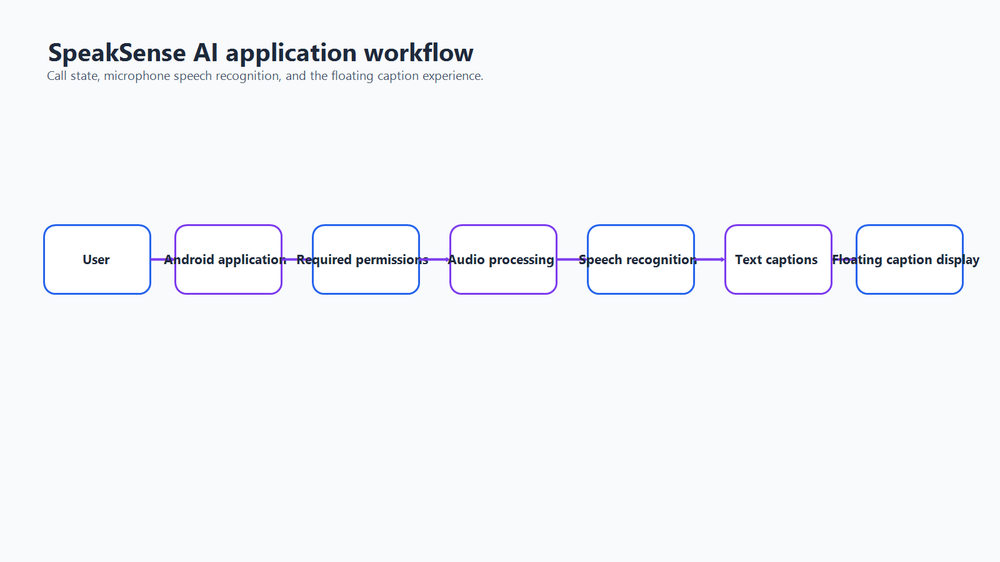
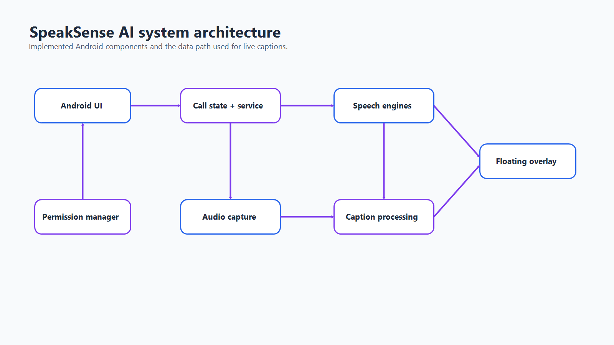
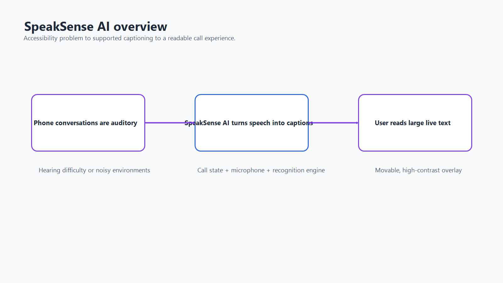

# SpeakSense AI — Every Word Matters

SpeakSense AI is an accessibility-focused Android application that helps people with hearing difficulties follow phone conversations through large, readable, real-time speech captions. It detects call state, captures microphone audio when Android and the device permit it, sends speech through a selectable recognition engine, and renders the resulting text in a movable floating caption window.

> **Important platform limitation:** Android does not grant ordinary applications direct access to the other participant's call downlink audio. SpeakSense AI's supported caption mode uses the microphone with speakerphone enabled, so device behavior varies and the user's own speech may also be captioned. The application reports when recognition is unavailable instead of claiming unsupported system access.

## Problem statement

Phone calls are primarily auditory. People who are deaf or hard of hearing, or who are in a noisy environment, may not be able to follow a conversation even when they can use the phone normally. A visible, high-contrast transcript can make the conversation easier to follow while keeping the interaction on the phone.

## Our solution

SpeakSense AI combines call-state monitoring, microphone capture, speech recognition, and a floating overlay. After setup and permission grants, the app can show live recognized speech above the call screen. Users can choose Telugu, English, or Telugu+English workflows and adjust caption size, width, opacity, and position.

## Implemented features

- Call-state detection for incoming, outgoing, active, and ended calls.
- Movable floating caption overlay with pause, resume, retry, close, auto-scroll, latest-line highlighting, Telugu Unicode support, and a recording indicator.
- Speech engines for Google Cloud streaming through a configured WebSocket server, Android `SpeechRecognizer`, an HTTPS custom backend, and a clearly reported Whisper.cpp placeholder.
- Best-effort Telugu, English, and mixed-language recognition.
- Setup wizard, dashboard status, microphone test, offline-model checks, and battery/OEM guidance.
- Optional encrypted transcript history using AES-256-GCM with Android Keystore; saving transcripts is off by default.
- Automatic cleanup when a call ends.

## Technology stack

- Kotlin, Android SDK 35, minimum Android API 31, Java 17.
- Jetpack Compose and Material 3 for the application UI.
- Android `TelephonyManager`/`PHONE_STATE` broadcast for call-state monitoring.
- Foreground microphone service and `TYPE_APPLICATION_OVERLAY` for the caption session.
- Android SpeechRecognizer, OkHttp, Kotlin Coroutines, Room, and KSP.
- Optional Python services using `faster-whisper`/Google Cloud integrations; see `backend-example/` and `backend-streaming/`.

## Application workflow

1. Install and open SpeakSense AI on an Android 12+ device.
2. Follow the setup wizard and grant microphone, phone-state, notifications, and overlay permissions as requested.
3. Start or receive a call. For the supported microphone mode, turn on speakerphone so the microphone can hear the caller.
4. `CallStateReceiver` and `CallStateMachine` identify the call phase and the foreground caption service manages the session.
5. `AudioCaptureManager` supplies microphone audio to the selected recognition engine. If a streaming server is not configured, the app falls back to Android's online recognizer when allowed.
6. Partial and final recognition results are passed through the session controller and caption repository.
7. `FloatingCaptionManager` displays readable captions over the call screen and exposes pause/resume/close controls.
8. When the call ends, the service stops recognition, audio capture, the overlay, and its notification.

## System architecture

The diagrams below describe the implemented component boundaries and user-visible flow.



*Application workflow from call setup through live captions.*



*Runtime components and the paths used by permissions, audio, recognition, and captions.*

## Application overview



*The accessibility problem, the SpeakSense AI intervention, and the reading experience.*

## Installation and setup

### Requirements

- Android Studio with JDK 17.
- Android SDK Platform 35 and build tools installed through Android Studio.
- Android 12 (API 31) or newer for device testing.

### Build

```bat
git clone https://github.com/Avinash-Sunkara/SpeakSence-AI.git
cd SpeakSence-AI
gradlew.bat assembleDebug
```

Open the project in Android Studio, allow Gradle sync to finish, connect a device with USB debugging enabled, and run the `app` configuration. The debug APK is written to `app\\build\\outputs\\apk\\debug\\app-debug.apk`.

Run unit tests with:

```bat
gradlew.bat testDebugUnitTest
```

No API keys are bundled in the Android project. The optional streaming and custom-backend modes require separately hosted services and credentials configured locally in the app settings; never commit those values.

## Project structure

```text
app/src/main/java/com/speaksense/ai/
├── audio/          Microphone capture and audio framing
├── call/           Call receiver, monitor, and state machine
├── data/           Settings, captions, encryption, and repositories
├── overlay/        Movable floating caption window
├── permissions/    Runtime permission and battery helpers
├── service/        Foreground caption session and notifications
├── speech/         Android, streaming, remote, and Whisper engine adapters
└── ui/             Compose screens, navigation, and theme
backend-example/    Optional phrase-based HTTPS backend
backend-streaming/  Optional continuous streaming proxy
docs/               Architecture, feasibility, testing, and diagrams
```

## Permissions and privacy

The manifest requests `RECORD_AUDIO`, `READ_PHONE_STATE`, `SYSTEM_ALERT_WINDOW`, `POST_NOTIFICATIONS`, foreground-service permissions, `INTERNET`, and `ACCESS_NETWORK_STATE`. These support microphone captioning, call-state awareness, the visible overlay, the foreground notification, and optional online recognition. The app deliberately does not request contacts, SMS, call-log, or accessibility-service permissions.

Call audio is not saved by the Android app. Transcript history is disabled by default; when enabled, the existing repository encrypts stored transcript data with Android Keystore-backed AES-256-GCM. Online recognition or a configured backend can transmit audio or speech text to that service, so users should review the selected engine and applicable law before use. Participants may need to be informed that captions are being made.

## Known limitations

- Android device/OEM rules may provide silence to the microphone during calls.
- Speakerphone is required for the supported microphone mode, and the user's own voice can be recognized too.
- Android's recognizer runs one language at a time; mixed-language recognition is best effort.
- Public Android APIs do not expose a general-purpose call-caption downlink or a reliable connected-state callback for outgoing calls.
- Whisper.cpp is an integration slot and is not bundled with a native model.

## Future enhancements

Potential improvements include broader device compatibility testing, a bundled offline Telugu model when licensing and size allow, stronger lifecycle recovery on OEM Android builds, richer speaker/language handling, and a production-hosted streaming service.

## Contributors

No verified contributor list was present in the project metadata. The repository owner is represented by the supplied GitHub repository URL.

## License

No license file or license declaration was present in the inspected project. All rights remain with the copyright holder until a license is added.
